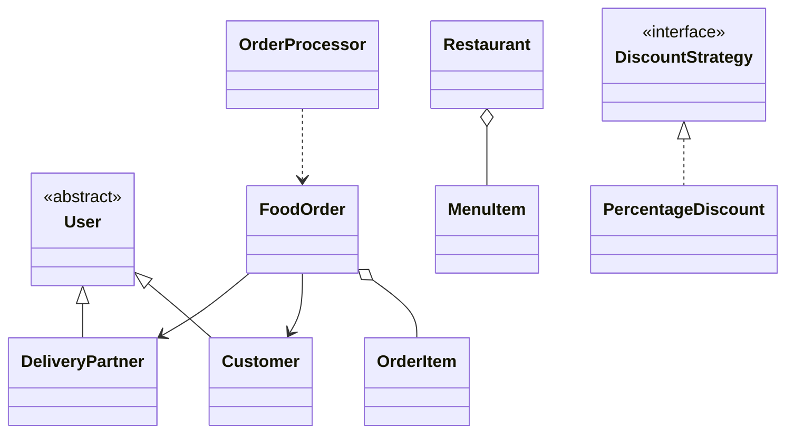

# Food Delivery Platform Simulator

Java Swing mini project for placing food orders, applying coupons, tracking order status, assigning delivery partners, and viewing order history and restaurant sales.

## Requirements
- JDK 17 or later
- Windows, macOS, or Linux

## Run
From the repository root:

```sh
./run.sh
```

On Windows PowerShell:

```powershell
.\run.ps1
```

For a desktop-style launch, double-click **Foodly - Campus Food Delivery** on the Windows Desktop. It uses `launch.vbs` to start the app without leaving a PowerShell window open. The shortcut uses the branded `Foodly.ico` icon.

The app stores order history in `data/orders.csv` and creates it on first run. Use **Launch Demo** to open the Swing application. The demo also runs a console sample and demonstrates order status progression on a worker thread.

## Features
- Restaurant menu and customer records
- Cart and total calculation with delivery charges and coupon strategy
- Order lifecycle: PLACED → PREPARING → ON_THE_WAY → DELIVERED
- Delivery partner assignment from available partners
- File-backed order history and restaurant sales summary
- Swing GUI with event handling
- Polished card-based desktop interface with branded header, status activity panel, and responsive spacing
- Custom exception for closed restaurants

## Packages
- `model`: Customer, restaurant, menu, order, partner and enums
- `service`: ordering, coupons, assignment, reports and background order processing
- `exception`: domain exception
- `ui`: Swing user interface and application entry point
- `util`: CSV persistence and seed data

## UML overview


## Sample data and testing
The application seeds 3 restaurants, 5 menu items, 3 customers, and 3 delivery partners. Try placing an order with a valid restaurant and customer, use coupon `SAVE10`, and verify the order appears in history. Invalid IDs, empty carts, and closed restaurants show readable error messages.

## Team
Team 2 (roll numbers 6–10). Member names and contributions are listed as placeholders until the team fills them in.
